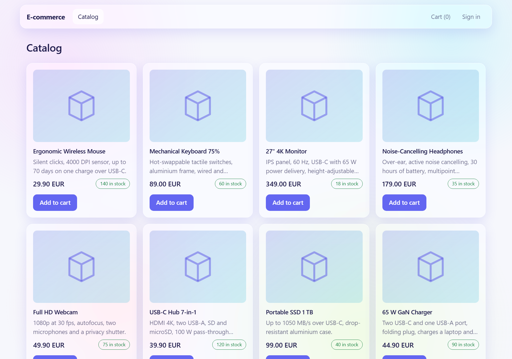
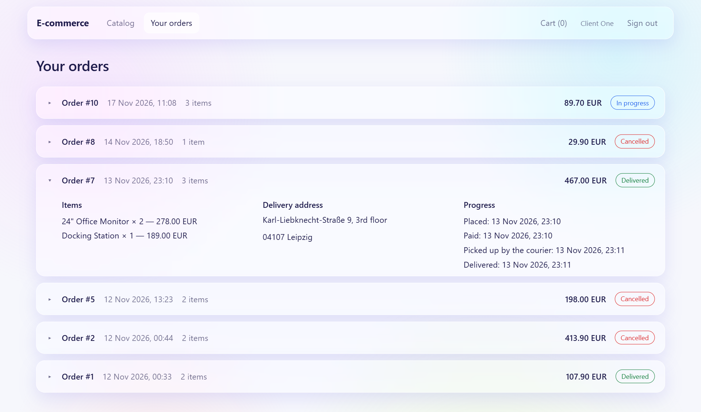
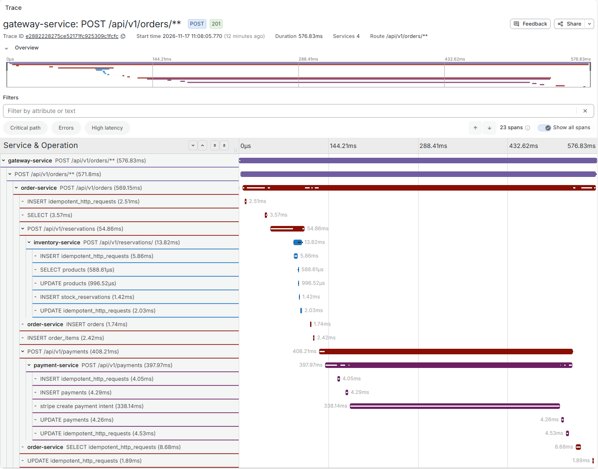
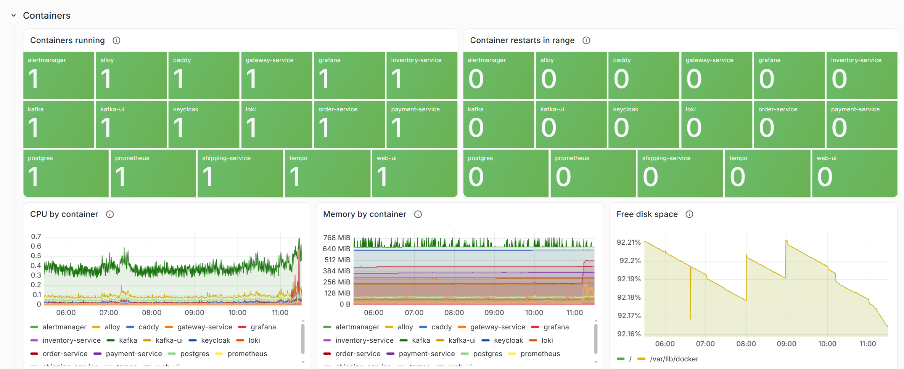
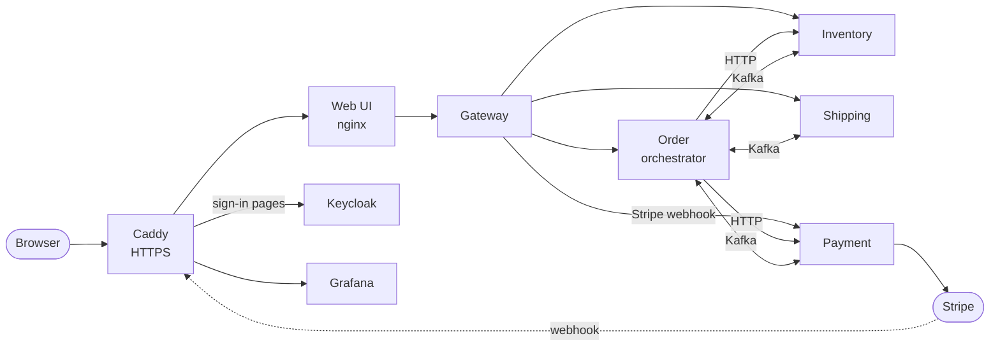

# E-commerce-App

An online shop built as a set of microservices: four business services in Go, Kotlin and Java coordinate every order
through a **saga** over Kafka and HTTP, behind one gateway, with Keycloak for sign-in, Stripe (test mode) for payments
and a full observability stack (logs, traces, metrics, alerts) in Grafana. It runs in production on a single VPS
with Docker Compose, deployed by GitHub Actions from version tags; the plan is to move it to Kubernetes, and then to
AWS EKS.

<p>
  <a href="https://ihorhartmann.com"></a>
  <a href="https://grafana.ihorhartmann.com"></a>
  <a href="docs/order_saga.md"></a>
</p>

<p><a href="#try-it">All accounts, test cards and a walk-through ↓</a></p>



## Try it

Everything below is public - the accounts exist only for the demo.

### Accounts

| Where | User | Password | Role | Can |
|---|---|---|---|---|
| [Shop](https://ihorhartmann.com) | `client1`, `client2` | `demo` | client | browse, buy, see and cancel own orders|
| [Shop](https://ihorhartmann.com) | `courier1`, `courier2` | `demo` | courier | see the shipments waiting for a courier, pick one up (its street shows only then), then deliver it, lose it, cancel it (the goods couldn't be handed over) or return it to the warehouse |
| [Grafana](https://grafana.ihorhartmann.com) | `observer` | `demo` | viewer | every dashboard, and Explore over the logs, traces and metrics - read-only, with no personal data |

You can also register in the shop: a new account is a client. The shop and Grafana are separate Keycloak realms, each 
with its own session, so you can be signed in to both
at once with different accounts. The shop's admin, who manages the catalog, is not public.

### Payment cards

Payments go through Stripe in **test mode** - no real money moves. With every card: any future expiry date, any CVC,
any postal code. A declined payment leaves the order open, so it can be paid again with another card.

| Card | Type | What happens |
|---|---|---|
| `4242 4242 4242 4242` | Visa | paid at once - the order moves on to shipping |
| `5555 5555 5555 4444` | Mastercard | paid at once |
| `4000 0000 0000 0002` | declined | generic decline (`card_declined`) |
| `4000 0000 0000 9995` | declined | insufficient funds (`insufficient_funds`) |
| `4000 0000 0000 0069` | declined | expired card (`expired_card`) |
| `4000 0000 0000 0127` | declined | incorrect CVC (`incorrect_cvc`) |
| `4000 0025 0000 3155` | 3-D Secure | Stripe opens an authentication window: *Complete* - the payment goes through, *Fail* - it is declined |

An order that isn't paid within 15 minutes is cancelled, and its stock goes back to the catalog.

### A walk-through

1. **Buy.** Sign in to the shop as `client1`, put a few products into the cart and check out:
    * **delivery address** - city, postal code and street are required (any values), the apartment/floor is optional;
    * **card** - number `4242 4242 4242 4242`, expiry date any month in the future (e.g. `12/34`), CVC any three
      digits (e.g. `123`).  Everything else it offers (e.g. saving the card with Link) is optional - skip it.

   The order is `PLACED` while the payment is being confirmed, then `PROCESSING`: stock reserved, paid, a shipment
   created.
2. **Deliver.** In a private window (or another browser) sign in as `courier1`, open *Shipments*, pick the order's
   shipment up and mark it delivered. Back as `client1`, the order is `FULFILLED`.
3. **Cancel and refund.** Place another order and cancel it - before the courier picks it up, or after. The stock
   is released (or, after a pickup, returned by the courier), the money refunded through Stripe, and the order ends
   `CANCELLED`. The courier can also lose a shipment, or fail to hand it over: the order is cancelled and refunded too.
4. **Fail.** Pay with a declined card, or leave an order unpaid, or cancel it before paying: nothing is charged, and
   the reservation is released.
5. **Watch it.** Open [Grafana](https://grafana.ihorhartmann.com) as `observer`, then *Dashboards* in the menu on the
   left, folder *E-commerce*. Its dashboards (each links to the others at the top):
    * **Order journey** - enter an order's id: every trace and every log line of its saga, across all the services;
    * **Saga** - orders by status, how long the saga takes, payments, refunds, shipments, stuck orders;
    * **Overview** - is everything fine right now: the symptoms of every service side by side;
    * **Service** - one service in depth: HTTP, Kafka, errors, outgoing calls, database, runtime, logs and traces;
    * **Infrastructure** - containers, disk, Postgres, Kafka, Keycloak and the telemetry pipeline itself.


<p align="center"><sub>A customer's orders - in progress, delivered, cancelled and refunded</sub></p>


<p align="center"><sub>Placing an order, traced through four services - down to the SQL and the Stripe call</sub></p>


<p align="center"><sub>The Infrastructure dashboard: every container of the stack, its restarts, CPU and memory</sub></p>

Every step of each of these paths - who calls whom, over HTTP or Kafka, and how each failure is compensated - is in
**[docs/order_saga.md](docs/order_saga.md)**: the order's state machine, the sequence diagrams of every protocol,
the compensations and the Kafka topics.

## Architecture



Every service validates tokens with Keycloak's keys, the gateway and Grafana sign users in through it, and the
order-service gets its own token from it - directly inside the Docker network, not through Caddy.

The **Order service** orchestrates the saga: it reserves stock and starts the payment over HTTP (the customer has to
wait for both anyway), and drives everything after that - shipment, delivery, cancellation, refund - with Kafka
commands and events. Every service owns its schema in one Postgres; none reads another's tables.

> [!NOTE]
> **One database, a schema per service - on purpose.** Each service has its own schema (`inventory`, `orders`,
> `payment`, `shipping`) and its own migrations, and never touches another's, but they all live in one Postgres
> instance. That is deliberate and only to save resources: one database container instead of four on a single VPS.
> Nothing in the code depends on it - a service's schema can move to a database of its own by changing its connection
> settings alone.

| Service | Language | Architecture | Stack |
|---|---|---|---|
| Inventory | Go | Onion | Fiber, GORM, kafka-go |
| Order | Kotlin | Clean | Spring Boot, Hibernate, Resilience4j |
| Payment | Java | Hexagonal | Spring Boot, jOOQ, Stripe |
| Shipping | Go | Hexagonal | Gin, GORM, kafka-go |
| Gateway | Kotlin | - (routing and security only) | Spring Cloud Gateway, Spring Security OAuth2 |
| Web UI | Kotlin/JS | MVVM | Compose HTML, Ktor Client, Stripe.js, nginx |

Infrastructure: Postgres, Kafka (KRaft), Keycloak, and for observability Alloy, Loki, Tempo, Prometheus,
Alertmanager and Grafana. Conventions shared by all the services: [CLAUDE.md](CLAUDE.md).

### Notable design decisions

* **Reliable messaging.** Every Kafka message is written to a transactional outbox together with the change that
  causes it, so a message is sent if and only if its change is committed. Consumers are idempotent; a failed message
  is retried with exponential back-off, then moved to a dead-letter topic - permanent failures (a malformed message,
  a rule rejecting it) go there at once. Redriving is a deliberate manual step.
* **Facts, not a status.** An order records what happened to it (paid, cancellation requested, delivered, refunded,
  ...) and computes its status from those facts, so saga events that arrive late, twice or out of order are still
  handled correctly.
* **Concurrency.** Every entity has an optimistic-locking version; a concurrent change is a transient error - retried
  by Kafka consumers, a `503` over HTTP.
* **Retries are safe.** Placing an order carries an `Idempotency-Key`, so a double click or a retry after a timeout
  returns the same order instead of a second one; the services' calls to each other and to Stripe carry keys too, so a
  retry never reserves stock or charges a card twice.
* **Security.** The gateway signs browser users in (Authorization Code + PKCE) and keeps their tokens server-side;
  the browser holds only an `HttpOnly` session cookie. Every service validates the JWT itself and checks roles per
  endpoint and ownership per resource; service-to-service calls use their own client-credentials tokens. Secrets
  reach the containers as Docker secrets, never as environment variables.
* **Observability.** JSON logs with the same fields in every service, and one `correlationId` per saga that follows
  it through HTTP and Kafka; distributed traces across HTTP and Kafka; the same metric names everywhere; alerts on
  symptoms only, unit-tested with `promtool`, mailed by Alertmanager. Personal data is masked before Loki stores it.
* **Delivery.** Every service is versioned and released on its own (`order-service/v1.3.0`); a platform release
  (`v1.4.0`) pins the version of each, and deploying it - or rolling back to an earlier one - is one workflow run.
  A pull request into `main` must pass the whole suite: unit, integration (Testcontainers) and end-to-end tests
  against the full stack with real Stripe test mode.

## Running locally

1. Copy `example.env` to `.env` and put your Stripe test-mode keys into `STRIPE_SECRET_KEY` and
   `STRIPE_PUBLISHABLE_KEY`.
2. Forward Stripe's webhooks to the gateway and put the `whsec_...` secret it prints into `STRIPE_WEBHOOK_SECRET`.
   Keep it running: an order moves on only once Stripe's webhook reaches the gateway.

   ```bash
   stripe listen --all-snapshot --forward-to localhost:8080/api/v1/webhooks/stripe
   ```

3. Start everything:

   ```bash
   docker compose up -d --build
   ```

| What | URL |
|---|---|
| Web UI | http://localhost:3000 |
| Gateway | http://localhost:8080 |
| Grafana (anonymous admin locally) | http://localhost:8089 |
| Keycloak admin console (`KEYCLOAK_ADMIN_USER` / `KEYCLOAK_ADMIN_PASSWORD`) | http://localhost:8090/admin |
| Kafka UI | http://localhost:9098 |
| Services directly (debugging, e2e tests) | http://localhost:3001 (inventory) ... 3004 (shipping) |

The demo accounts are the same as in production; locally the shop's `admin` signs in with `APP_ADMIN_PASSWORD` from
`.env` and can create and edit products. Keycloak imports the realms (`docker/keycloak/realm-ecommerce.json`,
`docker/keycloak/realm-internal.json`) only when they don't exist yet: after changing a realm file, recreate the
database volume with `docker compose down -v`. The passwords and secrets of `.env` reach the containers as Docker
secrets (files in `/run/secrets`); in production they come from the files in `secrets/`.

## Development

### Getting a token

**Browser:** open http://localhost:8080/oauth2/authorization/keycloak and sign in; http://localhost:8080/api/v1/me
then shows who you are and your roles.

**curl** - password grant through the `e2e-tests` client (local only, off in production):

```bash
curl -s -X POST http://localhost:8090/realms/ecommerce/protocol/openid-connect/token -d grant_type=password -d client_id=e2e-tests -d username=client1 -d password=demo
```

Send the `access_token` as `Authorization: Bearer <token>`, e.g. to http://localhost:8080/api/v1/orders/1. It lives
5 minutes.

**Service token** - client credentials, as the order-service gets it:

```bash
curl -s -X POST http://localhost:8090/realms/ecommerce/protocol/openid-connect/token -u order-service:<ORDER_SERVICE_CLIENT_SECRET> -d grant_type=client_credentials
```

### Web UI

With the rest of the stack running in Docker, the Gradle dev server serves the UI from the sources and reloads the
page on every change. Stop the `web-ui` container first (`docker compose stop web-ui`), since both use the same port:

```bash
cd app/web-ui
WEB_UI_PORT=3000 GATEWAY_URL=http://localhost:8080 STRIPE_PUBLISHABLE_KEY=pk_test_... ./gradlew jsBrowserDevelopmentRun --continuous
```

Its architecture: [app/web-ui/CLAUDE.md](app/web-ui/CLAUDE.md).

### Tests

* Unit tests: `go test ./...` (inventory, shipping), `./gradlew test` (order, gateway), `mvn test` (payment).
* Web UI ViewModel tests: `./gradlew jsNodeTest` in `app/web-ui`.
* Go integration tests (Testcontainers): `go test -tags integration ./...`.
* Alert rules: `promtool test rules` over `docker/prometheus/tests/alerts_test.yaml`.
* E2E tests (`e2e_tests`, the whole stack via Testcontainers, real Stripe test mode):
    * stop the local stack first (`docker compose down`) - the tests start their own on the same ports and network;
    * the variables from `.env` must be in the environment, and the Stripe CLI must be installed;
    * on Windows with Docker Desktop also set `TESTCONTAINERS_DOCKER_SOCKET_OVERRIDE=/var/run/docker.sock`;
    * `./gradlew test` in `e2e_tests`.

In CI, every push of a branch runs the unit tests of the services it touches. A pull request into `main` runs the whole
suite (`full-suite.yml`) once it is ready for review, and again on every push after that; its "Full suite" check must
pass before the merge.

### Releases and deployment

Production runs the docker compose stack on one VPS behind Caddy, deployed by GitHub Actions from version tags:
[infrastructure/contabo/README.md](infrastructure/contabo/README.md).
