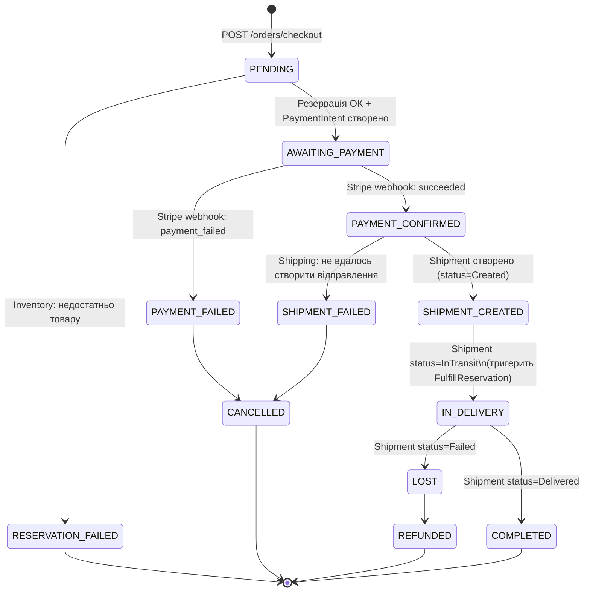
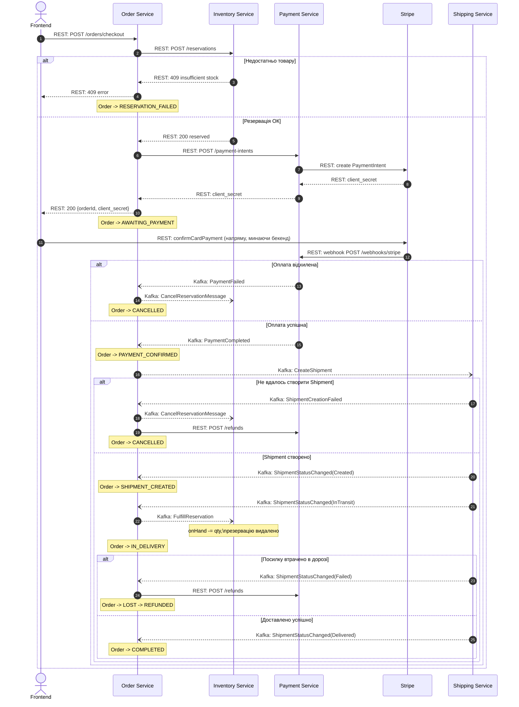

# Order Saga

Order Service — оркестратор саги оформлення замовлення. Документ описує повний
шлях замовлення від чекауту до доставки клієнту: хто з ким як спілкується
(REST чи Kafka) і що відбувається при збої на кожному кроці.

## Легенда

| Позначення | Означає |
|---|---|
| Суцільна стрілка (`->>` / `-->>`) | Синхронний REST-виклик і його відповідь |
| Пунктирна стрілка (`--)`) | Асинхронне повідомлення через Kafka |
| `alt / else` блок | Гілка збою і відповідна компенсація |

## Стани замовлення

## Повний протокол (REST + Kafka) з компенсаціями

## Компенсаційні кроки — короткий підсумок

**Немає товару на складі.** Найдешевша точка збою — до створення PaymentIntent
і до будь-якого списання коштів. Просто повертаємо помилку фронтенду,
компенсувати нічого не треба.

**Оплата відхилена.** Резервація вже існує, гроші не списані. Компенсація —
одна дія: `CancelReservationMessage` в Inventory, звільняємо склад.

**Не вдалось створити Shipment.** Гроші вже списані, резервація тримається.
Компенсація подвійна: скасувати резервацію в Inventory **і** повернути кошти
через Stripe refund у Payment Service.

**Посилку втрачено вже після pickup.** Склад фізично зменшений
(`FulfillReservation` уже виконано) — повертати товар на склад нема сенсу,
компенсація тут не "відкат" попереднього кроку, а новий крок: refund через
Payment. Це точка неповернення саги — до цього моменту всі збої
компенсуються поверненням до попереднього стану, після — лише грошовою
компенсацією.

## REST vs Kafka — де і чому

Резервація товару та створення Stripe PaymentIntent — синхронні REST-виклики
з Order, бо фронтенд чекає на відповідь у межах одного HTTP-запиту
(`POST /orders/checkout`) і має отримати або помилку "немає товару", або
`client_secret` для форми оплати. Все, що відбувається після появи сторінки
оплати — асинхронне через Kafka, бо ніхто синхронно не чекає на ці кроки:
підтвердження оплати, створення відправлення, зміна статусу доставки,
компенсації.
