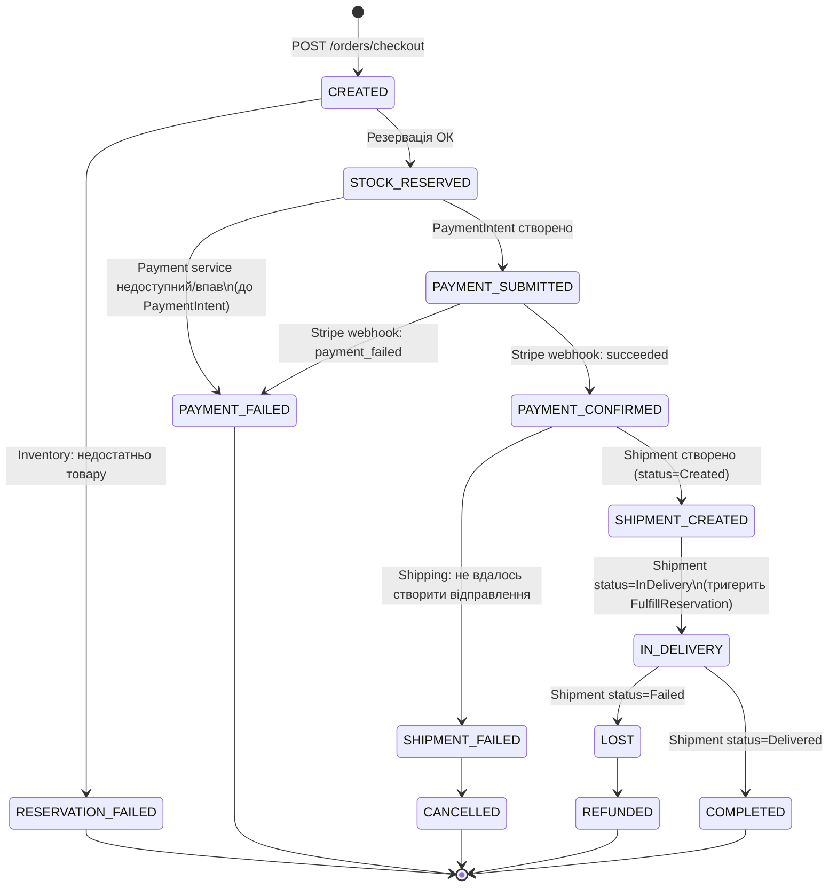
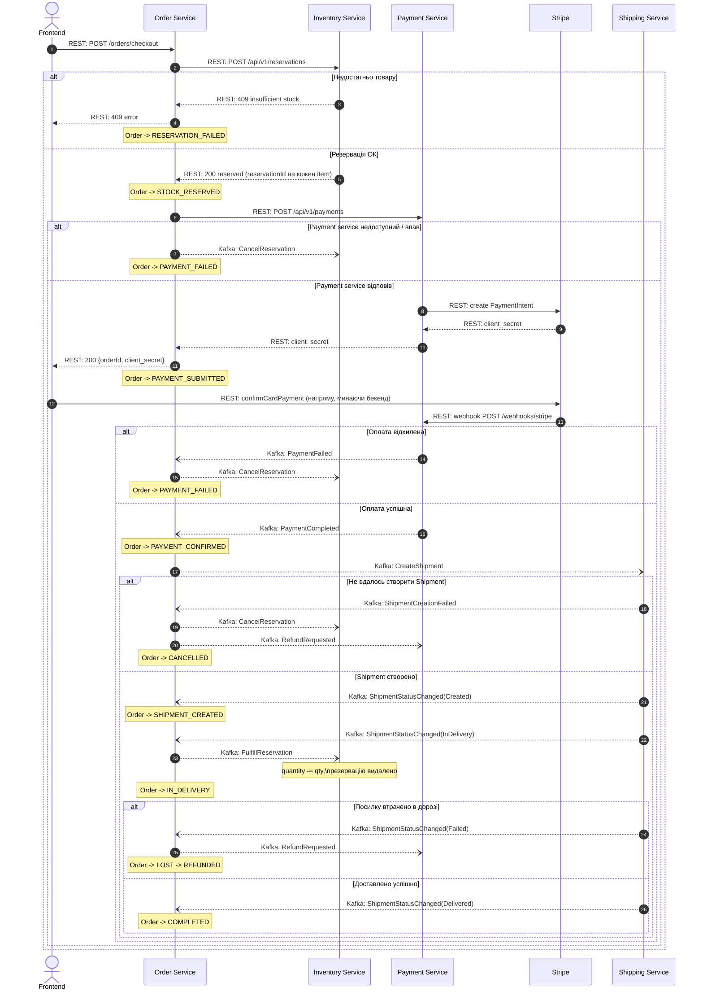

# Order Saga

Order Service — оркестратор саги оформлення замовлення. Документ описує повний
шлях замовлення від чекауту до доставки клієнту: хто з ким як спілкується
(REST чи Kafka) і що відбувається при збої на кожному кроці.

## Легенда

| Позначення | Означає |
|---|---|
| Суцільна стрілка (`->>` / `-->>`) | Синхронний REST-виклик і його відповідь |
| Пунктирна стрілка (`--)`) | Асинхронне повідомлення через Kafka |
| `alt / else` блок | Гілка збою і відповідна компенсація |

## Стани замовлення

## Повний протокол (REST + Kafka) з компенсаціями

Статус `Cancelled` у Shipping — валідний стан життєвого циклу посилки
(доступний напряму через REST), але сама сага сьогодні в нього не переходить
жодним із задокументованих кроків вище.

## Компенсаційні кроки — короткий підсумок

**Немає товару на складі.** Найдешевша точка збою — до створення PaymentIntent
і до будь-якого списання коштів. Просто повертаємо помилку фронтенду,
компенсувати нічого не треба.

**Payment service недоступний або впав.** Резервація вже існує (`STOCK_RESERVED`), запит
`POST /api/v1/payments` кинув виняток ще до відповіді від Stripe. Компенсація — та сама дія:
`CancelReservation` в Inventory, звільняємо склад, `Order -> PAYMENT_FAILED`. На
відміну від решти компенсацій це відбувається синхронно, всередині `OrderServiceImpl`, а не
через сагу.

**Оплата відхилена (Stripe).** Резервація вже існує, гроші не списані. Компенсація —
одна дія: `CancelReservation` в Inventory, звільняємо склад, `Order -> PAYMENT_FAILED`.

**Не вдалось створити Shipment.** Гроші вже списані, резервація тримається.
Компенсація подвійна: скасувати резервацію в Inventory **і** повернути кошти
через Payment Service — обидва кроки йдуть через Kafka
(`CancelReservation`, `RefundRequested`), REST тут більше не
використовується.

**Посилку втрачено вже після pickup.** Склад фізично зменшений
(`FulfillReservation` уже виконано) — повертати товар на склад нема сенсу,
компенсація тут не "відкат" попереднього кроку, а новий крок: `RefundRequested`
через Kafka в Payment. Це точка неповернення саги — до цього моменту всі збої
компенсуються поверненням до попереднього стану, після — лише грошовою
компенсацією.

## REST vs Kafka — де і чому

Резервація товару (`POST /api/v1/reservations`) та створення Stripe
PaymentIntent (`POST /api/v1/payments`) — синхронні REST-виклики з Order, бо
фронтенд чекає на відповідь у межах одного HTTP-запиту
(`POST /orders/checkout`) і має отримати або помилку "немає товару", або
`client_secret` для форми оплати. Все, що відбувається після появи сторінки
оплати — асинхронне через Kafka, бо ніхто синхронно не чекає на ці кроки:
підтвердження оплати, створення відправлення, зміна статусу доставки,
компенсації (включно з refund — раніше refund йшов через REST `POST
/refunds`, але жодна компенсація не є time-sensitive для фронтенду, тож
`RefundRequested` тепер теж Kafka-подія, а не REST-виклик).

## Kafka-топіки

Топік на кожен домен-виробник + тип повідомлення (command/event), а не на
кожен окремий тип події — див. обговорення переваг цього підходу окремо.
Порядок повідомлень одного агрегату (замовлення/посилки) гарантується
ключем партиціювання (`orderId`/`shipmentId`), а не розбиттям на топіки.

| Топік | Продюсер | Консьюмер | Повідомлення |
|---|---|---|---|
| `inventory.commands` | Order | Inventory | `CancelReservation`, `FulfillReservation` |
| `shipping.commands` | Order | Shipping | `CreateShipment` |
| `payment.commands` | Order | Payment | `RefundRequested` |
| `payment.events` | Payment | Order | `PaymentCompleted`, `PaymentFailed` |
| `shipping.events` | Shipping | Order | `ShipmentCreationFailed`, `ShipmentStatusChanged` |

Команди (`*.commands`) — наказ конкретному сервісу щось зробити, одна цільова
дія. Події (`*.events`) — факт, що стався; сьогодні їх читає лише Order, але
формат не прив'язаний до єдиного консьюмера. Кожне повідомлення несе
конверт `eventType` + `correlationId` (+ `eventId`) поверх JSON-пейлоада, щоб
консьюмер топіка з кількома типами повідомлень міг коректно розпізнати, що
саме прийшло.
