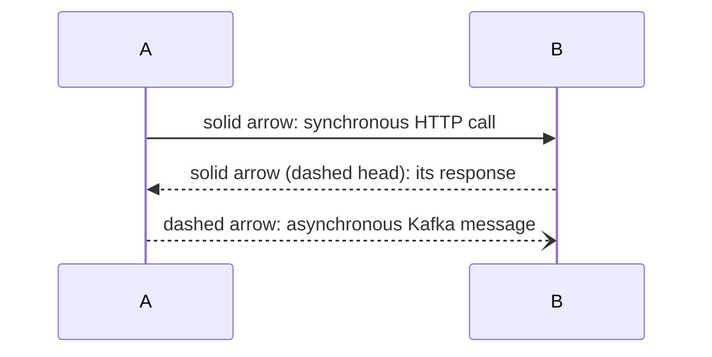
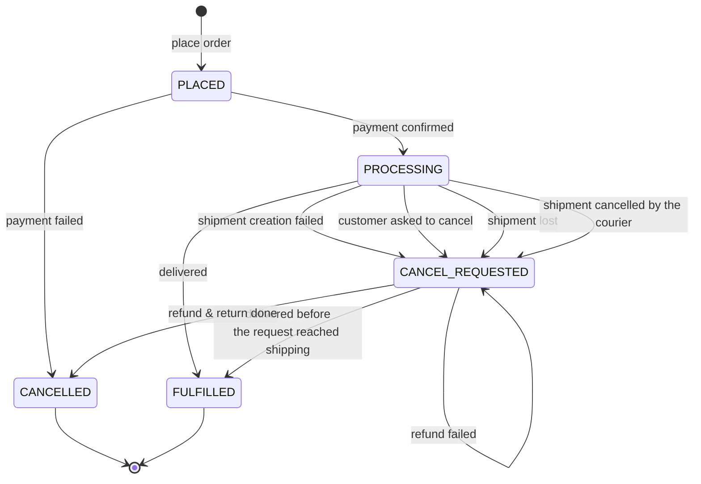
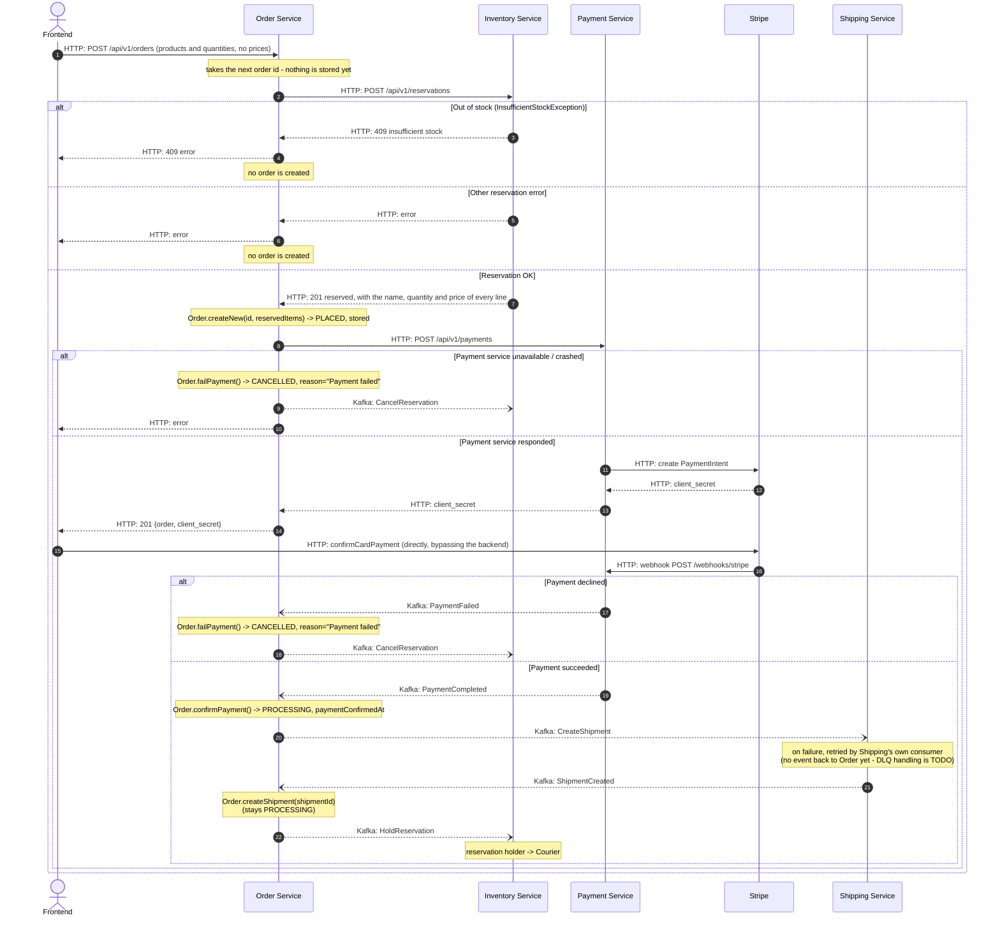
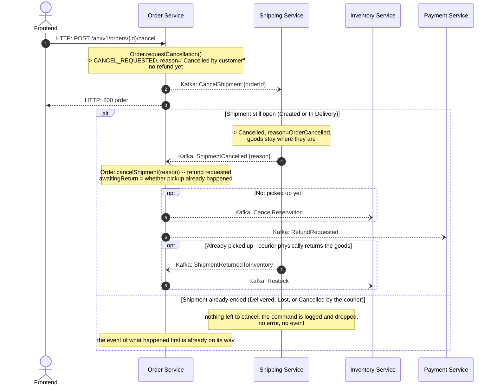

# Order Saga

Order Service is the orchestrator of the order placement saga. This document
describes the full path of an order from checkout to delivery: who talks to
whom and how (HTTP or Kafka), and what happens on failure at each step.

## Legend

An `alt / else` block in a diagram marks a failure branch and its compensation.

## Order states

`OrderStatus` covers five broad values - the detailed saga progress
(payment confirmed, picked up, returned to inventory, etc.) isn't tracked as
separate statuses but as nullable facts on `Order` (`paymentConfirmedAt`,
`shipment.pickedUpAt`, `shipment.deliveredAt`, `refund.confirmedAt`,
`refund.failedAt`, `shipment.returnedAt`) plus an `awaitingReturn` flag.

Labels above are kept short for rendering; exact `cancellationReason` values
for each `-> CANCELLED` / `-> CANCEL_REQUESTED` trigger are listed in
"Compensation steps" below.

`CANCEL_REQUESTED` covers two phases, told apart by whether a refund was
requested (`refund`):

1. **awaiting shipping** - the customer asked to cancel, and Shipping hasn't
   answered yet. Nothing is refunded or released, and the shipment's events
   are still accepted (see "Customer cancels the order" below);
2. **cancellation confirmed** - the shipment is cancelled or lost, the refund
   is requested, and the order waits for it and, after a pickup, for the
   goods to come back.

`RefundFailed` deliberately doesn't move the status - it's a flag for support
(`refund.failedAt`), not a separate stage: without manual intervention
(re-requesting the refund) the order simply stays in `CANCEL_REQUESTED`. This
is intentional: staying in `CANCEL_REQUESTED` instead of moving to some
dead-end status keeps the order visible in whatever view tracks "still needs
to be resolved" - so an order with a failed refund can't quietly fall through
the cracks and get forgotten.

## Protocol: checkout → payment → shipment creation

## Protocol: delivery → outcome (Delivered / Lost / Cancelled)

Continues from the point where the `Shipment` has already been created
(status `Created`, `Order` in `PROCESSING`). Courier actions
(`pickup`/`deliver`/`lose`/`cancel`/`return`) are HTTP calls made directly to
the Shipping Service, not through Order, and only the courier who picked the
shipment up may make any of them after the pickup. A courier's `cancel` means
the goods couldn't be handed over, and carries the reason: `RecipientRefused`
or `RecipientUnavailable` (nobody there, wrong address). The customer cancels
the order through Order instead - see the next protocol.

`RefundCompleted`/`RefundFailed` and `ShipmentReturnedToInventory` are two
independent events that can arrive in either order (refund confirmation is
typically much faster than the courier's physical trip back).
`Order.confirmRefund`/`Order.returnToStock` each check whether the OTHER half
has already completed before finalizing to `CANCELLED` - that's exactly what
`awaitingReturn` is for.

## Protocol: customer cancels the order

The customer cancels the **order**, through Order - never the shipment. Only a
paid order whose shipment hasn't ended can be cancelled (`PROCESSING`); an
unpaid one (`PLACED`) simply expires, and a `FULFILLED` or `CANCELLED` one is
rejected with `409`. Asking again while a cancellation is under way changes
nothing.

Order only **asks**: Shipping owns the shipment and decides whether it can
still be cancelled. So the request moves the order to `CANCEL_REQUESTED`
without refunding anything, and the refund starts only once Shipping confirms.

The refund and the return then finish as in the previous protocol.

**The command can come too late.** The customer and the courier act
independently, and messages between Order and Shipping take time, so an event
about what the courier did *before* Shipping handled `CancelShipment` can
reach an order that is already `CANCEL_REQUESTED`. Order accepts each of them
while it awaits Shipping (`CreateShipment` and `CancelShipment` share the key
`orderId`, so Shipping always sees them in order):

| Event | What Order does while awaiting Shipping |
|---|---|
| `ShipmentCreated` | stores `shipmentId`, keeps waiting |
| `ShipmentInDelivery` | records the pickup, `FulfillReservation`, keeps waiting |
| `ShipmentDelivered` | `FULFILLED` - the request came too late, the cancellation reason is dropped |
| `ShipmentLost` | reason becomes "Shipment lost", refund requested, no return awaited |
| `ShipmentCancelled` | cancellation confirmed, refund requested; the reason stays "Cancelled by customer" even if the courier cancelled on their own first |

Shipping never answers a late command with an error or a "rejected" event: a
cancellation that lost the race is not a failure, and the order leaves the
waiting phase through one of the events above.

## Compensation steps - quick summary

**Out of stock.** The cheapest failure point - before the order is stored, before
the PaymentIntent is created and before any charge. Just return an error to the
frontend: no order exists, so there is nothing to compensate.

**Payment service unavailable or crashed.** The reservation already exists,
the `POST /api/v1/payments` request threw before Stripe ever responded. The
compensation is the same action: `CancelReservation` in Inventory.

**Payment declined (Stripe).** The reservation already exists, no money was
charged. The compensation is one action: `CancelReservation` in Inventory.

**Shipment creation failed.** Money was already charged, the reservation is
still held. The compensation is threefold: cancel the reservation in
Inventory, request a refund from Payment, and wait for its confirmation - all
through Kafka.

**Shipment cancelled BEFORE pickup.** Only the customer can cause it, by
cancelling the order. The reservation hasn't been fulfilled yet - the
compensation mirrors the previous case: `CancelReservation` +
`RefundRequested`.

**Shipment cancelled AFTER pickup.** By the customer cancelling the order
(`cancellationReason` "Cancelled by customer"), or by the courier who couldn't
hand the goods over ("Cancelled by customer" if the recipient refused them,
"Delivery failed" if nobody could take them). Stock has already been physically
decremented (`FulfillReservation` already ran) - `CancelReservation` makes no
sense here. Instead, the order waits for TWO independent events: refund
confirmation and the courier physically returning the goods (`Restock` in
Inventory). Only once both have happened does the order become `CANCELLED`.

**Shipment lost after pickup.** The goods are never coming back
(`awaitingReturn` is always `false` on this path) - the only compensation is
`RefundRequested` via Kafka to Payment.

**Refund failed at Stripe.** `RefundFailed` only flags `refund.failedAt` -
the order stays in `CANCEL_REQUESTED` with no automatic retry; it needs
manual intervention (support / re-requesting the refund).

## Kafka topics

One topic per producing domain + message kind (command/event). Message ordering for a given aggregate (order /
shipment) is guaranteed by the partitioning key (`orderId`), not
by splitting into topics.

| Topic | Producer | Consumer | Messages |
|---|---|---|---|
| `inventory.commands` | Order | Inventory | `CancelReservation`, `FulfillReservation`, `HoldReservation`, `Restock` |
| `shipping.commands` | Order | Shipping | `CreateShipment`, `CancelShipment` |
| `payment.commands` | Order | Payment | `RefundRequested` |
| `payment.events` | Payment | Order | `PaymentCompleted`, `PaymentFailed`, `RefundCompleted`, `RefundFailed` |
| `shipping.events` | Shipping | Order | `ShipmentCreated`, `ShipmentInDelivery`, `ShipmentDelivered`, `ShipmentCancelled`, `ShipmentLost`, `ShipmentReturnedToInventory` |

Commands (`*.commands`) are an order to a specific service to do one targeted
thing. Events (`*.events`) are a fact that happened. Every message carries
an `eventType`, `correlationId`, `eventId` envelope on top of the JSON
payload, so a consumer on a topic with multiple message types can correctly
recognize what just arrived.
