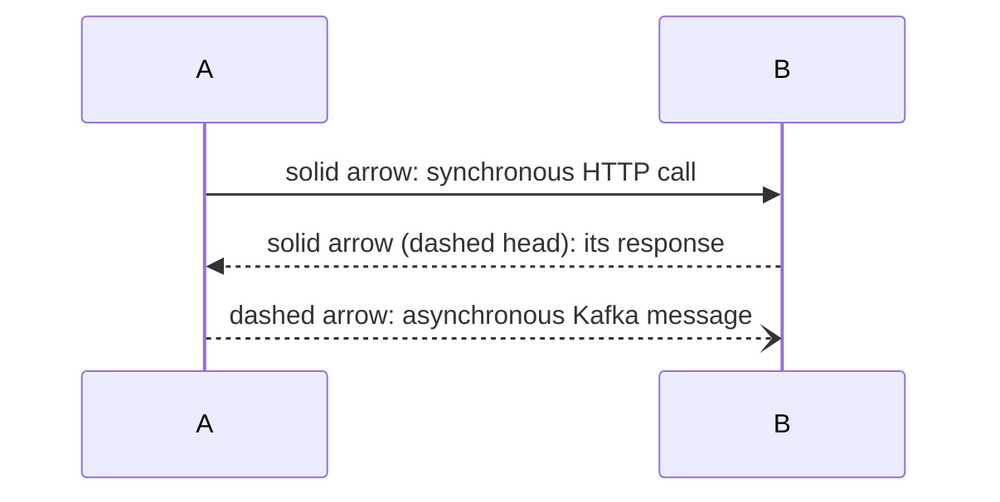
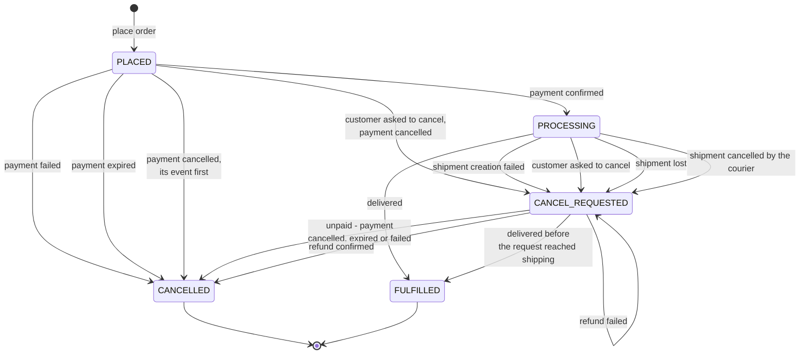
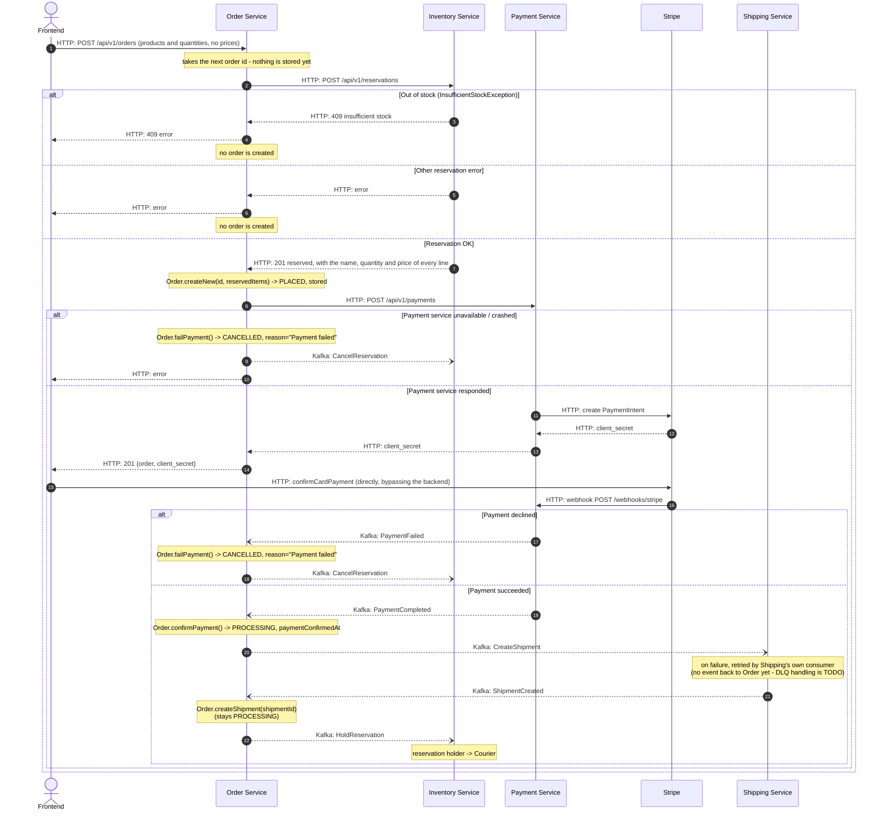
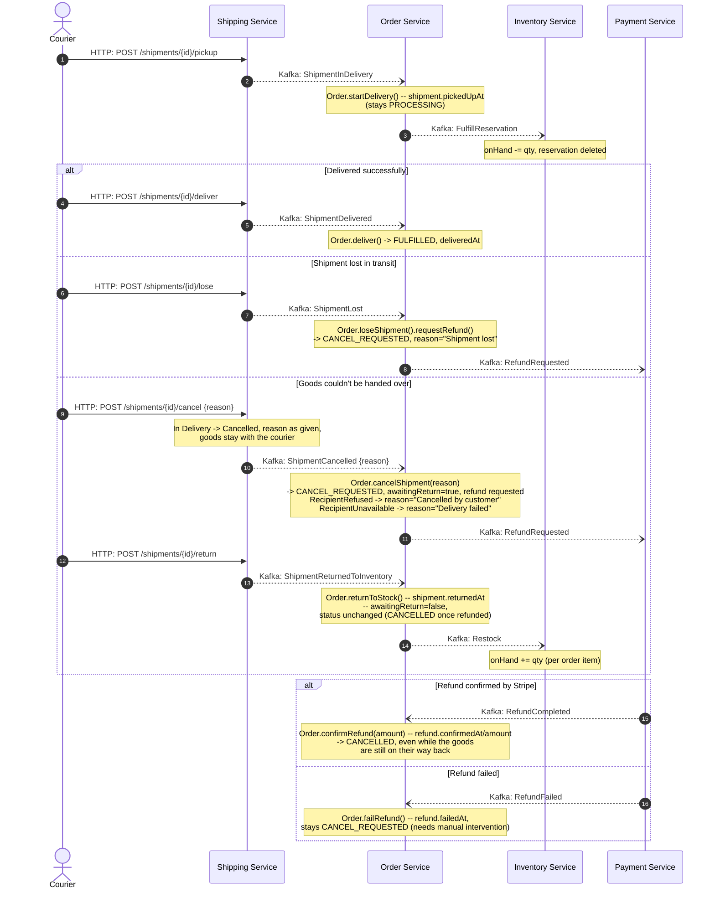
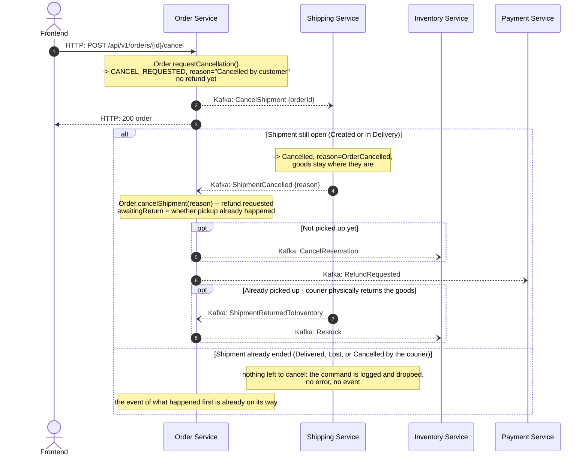
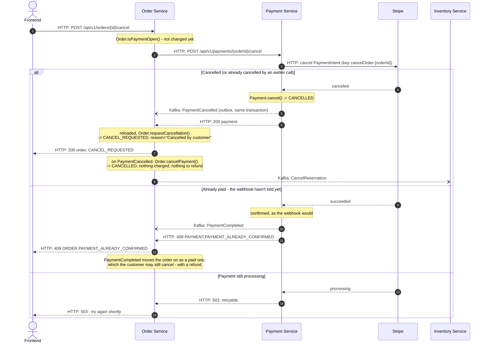

# Order Saga

Order Service is the orchestrator of the order placement saga. This document
describes the full path of an order from checkout to delivery: who talks to
whom and how (HTTP or Kafka), and what happens on failure at each step.

## Legend

An `alt / else` block in a diagram marks a failure branch and its compensation.

## Order states

`Order` keeps **facts**, not a status: each step of the saga leaves its own
nullable timestamp - `paymentConfirmedAt`, `cancellationRequestedAt` (with its
`cancellationReason`), `cancelledAt`, `shipment.pickedUpAt`,
`shipment.deliveredAt`, `shipment.returnedAt`, `refund.requestedAt`,
`refund.confirmedAt`, `refund.failedAt` - plus an `awaitingReturn` flag. Every
rule asks the facts (is it paid, is its shipment still open), never the status:
the saga's events may come late, twice or out of order, and a fact answers what
a rule actually needs to know.

`OrderStatus` is what the facts add up to, computed in one place
(`Order.status`), the first that applies:

| Fact | Status |
|---|---|
| `shipment.deliveredAt` | `FULFILLED` - a delivery wins over a cancellation that came too late |
| `cancelledAt` | `CANCELLED` |
| `cancellationRequestedAt` | `CANCEL_REQUESTED` |
| `paymentConfirmedAt` | `PROCESSING` |
| none of them | `PLACED` |

The repository stores it next to the facts, for queries (a customer's orders,
the orders-by-status metrics), and checks on load that it still matches them.

The status follows the customer's side of the order. Logistics the customer
has no part in - the courier bringing cancelled goods back to the warehouse -
is recorded on the order (`awaitingReturn`, `shipment.returnedAt`) but never
holds its status back, and isn't part of the customer's `OrderResponse`.

Labels above are kept short for rendering; exact `cancellationReason` values
for each `-> CANCELLED` / `-> CANCEL_REQUESTED` trigger are listed in
"Compensation steps" below.

`CANCEL_REQUESTED` means only that the order is being cancelled, whatever
stage it's at. Its facts tell the phases apart:

1. **unpaid** (no `paymentConfirmedAt`) - Payment has already cancelled the
   payment, so it can no longer be paid; `PaymentCancelled` finishes the
   cancellation (see "Customer cancels an unpaid order" below);
2. **awaiting shipping** (paid, no `refund`) - the customer asked to cancel, and Shipping hasn't
   answered yet. Nothing is refunded or released, and the shipment's events
   are still accepted (see "Customer cancels the order" below);
3. **cancellation confirmed** (`refund` requested) - the shipment is cancelled or lost, the refund
   is requested, and the order waits for its confirmation. After a pickup, the
   goods' trip back to the warehouse runs alongside and doesn't hold the
   order back.

`RefundFailed` deliberately doesn't move the status - it's a flag for support
(`refund.failedAt`), not a separate stage: without manual intervention
(re-requesting the refund) the order simply stays in `CANCEL_REQUESTED`. This
is intentional: staying in `CANCEL_REQUESTED` instead of moving to some
dead-end status keeps the order visible in whatever view tracks "still needs
to be resolved" - so an order with a failed refund can't quietly fall through
the cracks and get forgotten.

## Protocol: checkout → payment → shipment creation

## Protocol: delivery → outcome (Delivered / Lost / Cancelled)

Continues from the point where the `Shipment` has already been created
(status `Created`, `Order` in `PROCESSING`). Courier actions
(`pickup`/`deliver`/`lose`/`cancel`/`return`) are HTTP calls made directly to
the Shipping Service, not through Order, and only the courier who picked the
shipment up may make any of them after the pickup. A courier's `cancel` means
the goods couldn't be handed over, and carries the reason: `RecipientRefused`
or `RecipientUnavailable` (nobody there, wrong address). The customer cancels
the order through Order instead - see the next protocol.

`RefundCompleted`/`RefundFailed` and `ShipmentReturnedToInventory` are two
independent events that can arrive in either order (refund confirmation is
typically much faster than the courier's physical trip back). Only the refund
finalizes the order: `Order.confirmRefund` makes it `CANCELLED` whether or not
the goods are back. `Order.returnToStock` only records the return - it accepts
it once, and only while `awaitingReturn` is set, so a return the order doesn't
wait for (or a repeated one) is rejected instead of restocking twice.

## Protocol: customer cancels the order

The customer cancels the **order**, by calling Order - never shipping- or
payment-service directly. For an unpaid order, Order first cancels its payment
(see "Customer cancels an unpaid order" below); a paid one, whose shipment
hasn't ended (`PROCESSING`), as described here; a `FULFILLED` one is rejected
with `409`.
Asking again while the order is being cancelled, or once it's cancelled,
changes nothing: the order comes back as it is.

Order only **asks**: Shipping owns the shipment and decides whether it can
still be cancelled. So the request moves the order to `CANCEL_REQUESTED`
without refunding anything, and the refund starts only once Shipping confirms.

The refund and the return then finish as in the previous protocol.

**The command can come too late.** The customer and the courier act
independently, and messages between Order and Shipping take time, so an event
about what the courier did *before* Shipping handled `CancelShipment` can
reach an order that is already `CANCEL_REQUESTED`. Order accepts each of them
while it awaits Shipping (`CreateShipment` and `CancelShipment` share the key
`orderId`, so Shipping always sees them in order):

| Event | What Order does while awaiting Shipping |
|---|---|
| `ShipmentCreated` | stores `shipmentId`, keeps waiting |
| `ShipmentInDelivery` | records the pickup, `FulfillReservation`, keeps waiting |
| `ShipmentDelivered` | `FULFILLED` - the request came too late, the cancellation reason is dropped |
| `ShipmentLost` | reason becomes "Shipment lost", refund requested, no return awaited |
| `ShipmentCancelled` | cancellation confirmed, refund requested; the reason stays "Cancelled by customer" even if the courier cancelled on their own first |

Shipping never answers a late command with an error or a "rejected" event: a
cancellation that lost the race is not a failure, and the order leaves the
waiting phase through one of the events above.

## Protocol: customer cancels an unpaid order

An unpaid order's PaymentIntent is still payable, so it must be cancelled at
Stripe before anything else - otherwise the customer could still pay an order
that is already cancelled, its stock already released. Order asks Payment
synchronously, outside any database transaction, and only once Payment has
answered does it mark the order being
cancelled (`CANCEL_REQUESTED`) - in a transaction of its own, on the order
reloaded, since it may have changed while Payment was called. Payment's
`PaymentCancelled`, written to its outbox in the same transaction as the
cancelled payment, then finishes the cancellation.

Order's own commit of `CANCEL_REQUESTED` and its handling of
`PaymentCancelled` can come in either order, and neither depends on the other:

* `PaymentCancelled` is handled first: the order reloaded after Payment's
  answer is already `CANCELLED` - cancelled by the event, not by the request -
  and the request returns it as it is;
* Order fails to store `CANCEL_REQUESTED` after Payment's answer (or crashes):
  the order stays `PLACED` until `PaymentCancelled` cancels it all the same - it
  accepts an unpaid order whether or not it was marked. The customer, told of a
  failure, may ask again: Payment answers a payment it already cancelled as it
  is, so the retry succeeds.

`PaymentExpired` and `PaymentFailed` accept an unpaid order being cancelled
too - Payment answers `200` for a payment closed in any way, and the event that
closed it may be one of those - and keep the customer's reason: the order ends
the way they asked for.

A payment that is already cancelled, expired or failed is answered as it is,
with no new event: whatever closed it already told Order. If Stripe cancelled
the PaymentIntent but Payment failed to store it, the customer's next attempt
finds the PaymentIntent cancelled at Stripe and finishes the job; without one,
the expiration sweep does (see below).

## Protocol: unpaid payment expires

Payment's expiration sweep gives up on every open payment (`INITIATED`,
`PENDING`, `ATTEMPT_DECLINED`) past its `expiresAt` (15 minutes), one by one,
calling Stripe outside any database transaction:

1. its PaymentIntent, if it got one, is cancelled at Stripe first (key
   `expirePayment-{orderId}`, reason `abandoned`), so an expired payment can no
   longer be paid;
2. Stripe cancelled it: the payment is expired and `PaymentExpired` cancels the
   order (reason "Not paid in time") and releases its stock;
3. the customer paid it at the last moment: the payment is confirmed instead,
   and `PaymentCompleted` moves the order on - the webhook arriving later
   changes nothing;
4. Stripe is still processing it: it is left for the next run.

A payment that fails - Stripe unavailable, a concurrent update - is logged and
left open for the next run, which finds a PaymentIntent it already cancelled
at Stripe cancelled and finishes the job.

## Compensation steps - quick summary

**Out of stock.** The cheapest failure point - before the order is stored, before
the PaymentIntent is created and before any charge. Just return an error to the
frontend: no order exists, so there is nothing to compensate.

**Payment service unavailable or crashed.** The reservation already exists,
the `POST /api/v1/payments` request threw before Stripe ever responded. The
compensation is the same action: `CancelReservation` in Inventory.

**Payment declined (Stripe).** The reservation already exists, no money was
charged. The compensation is one action: `CancelReservation` in Inventory.

**Payment expired, or cancelled by the customer before paying.** No money was
charged, and the PaymentIntent is cancelled at Stripe so it can no longer be.
The compensation is one action: `CancelReservation` in Inventory.

**Shipment creation failed.** Money was already charged, the reservation is
still held. The compensation is threefold: cancel the reservation in
Inventory, request a refund from Payment, and wait for its confirmation - all
through Kafka.

**Shipment cancelled BEFORE pickup.** Only the customer can cause it, by
cancelling the order. The reservation hasn't been fulfilled yet - the
compensation mirrors the previous case: `CancelReservation` +
`RefundRequested`.

**Shipment cancelled AFTER pickup.** By the customer cancelling the order
(`cancellationReason` "Cancelled by customer"), or by the courier who couldn't
hand the goods over ("Cancelled by customer" if the recipient refused them,
"Delivery failed" if nobody could take them). Stock has already been physically
decremented (`FulfillReservation` already ran) - `CancelReservation` makes no
sense here. Instead, two independent things follow: the refund, whose
confirmation makes the order `CANCELLED`, and the courier physically returning
the goods (`Restock` in Inventory), which the order records but which doesn't
change its status.

**Shipment lost after pickup.** The goods are never coming back
(`awaitingReturn` is always `false` on this path) - the only compensation is
`RefundRequested` via Kafka to Payment.

**Refund failed at Stripe.** `RefundFailed` only flags `refund.failedAt` -
the order stays in `CANCEL_REQUESTED` with no automatic retry; it needs
manual intervention (support / re-requesting the refund).

## Kafka topics

One topic per producing domain + message kind (command/event). Message ordering for a given aggregate (order /
shipment) is guaranteed by the partitioning key (`orderId`), not
by splitting into topics.

| Topic | Producer | Consumer | Messages |
|---|---|---|---|
| `inventory.commands` | Order | Inventory | `CancelReservation`, `FulfillReservation`, `HoldReservation`, `Restock` |
| `shipping.commands` | Order | Shipping | `CreateShipment`, `CancelShipment` |
| `payment.commands` | Order | Payment | `RefundRequested` |
| `payment.events` | Payment | Order | `PaymentCompleted`, `PaymentFailed`, `RefundCompleted`, `RefundFailed` |
| `shipping.events` | Shipping | Order | `ShipmentCreated`, `ShipmentInDelivery`, `ShipmentDelivered`, `ShipmentCancelled`, `ShipmentLost`, `ShipmentReturnedToInventory` |

Commands (`*.commands`) are an order to a specific service to do one targeted
thing. Events (`*.events`) are a fact that happened. Every message carries
an `eventType`, `correlationId`, `eventId` envelope on top of the JSON
payload, so a consumer on a topic with multiple message types can correctly
recognize what just arrived.
