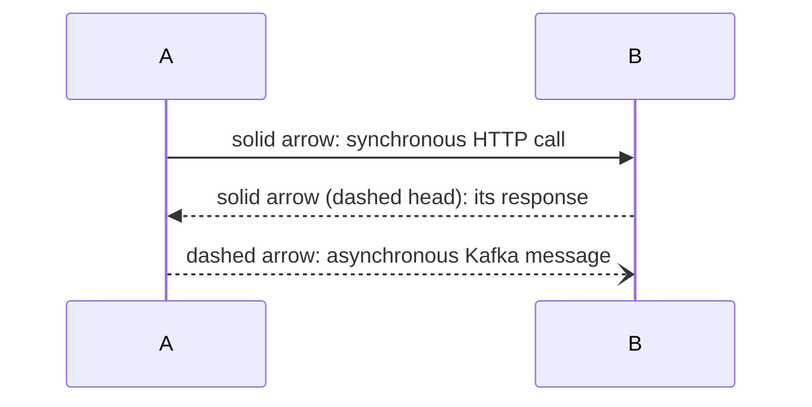
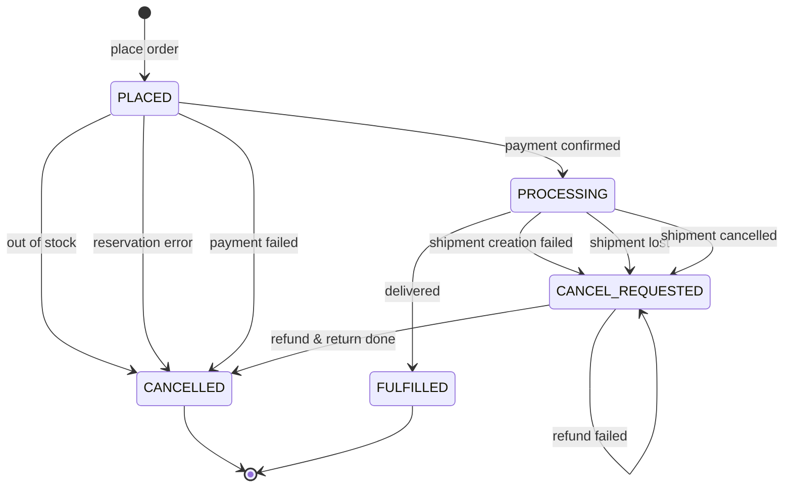
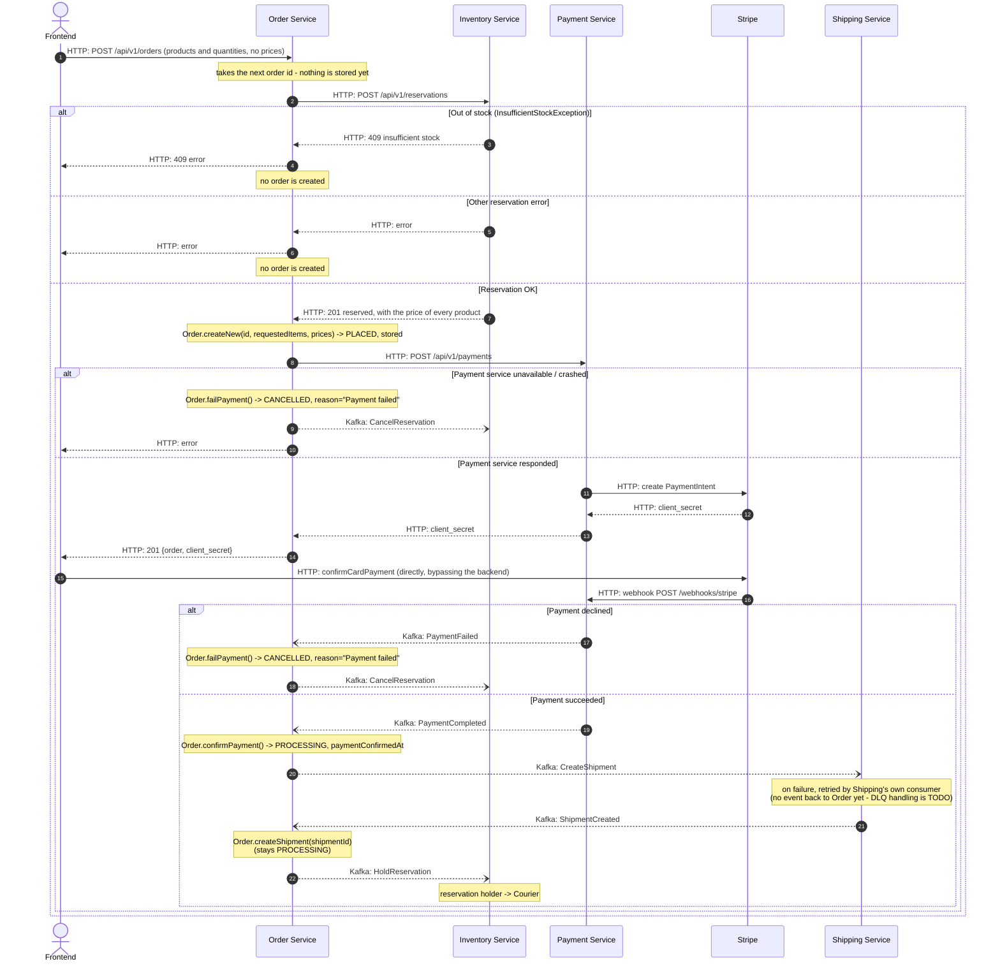
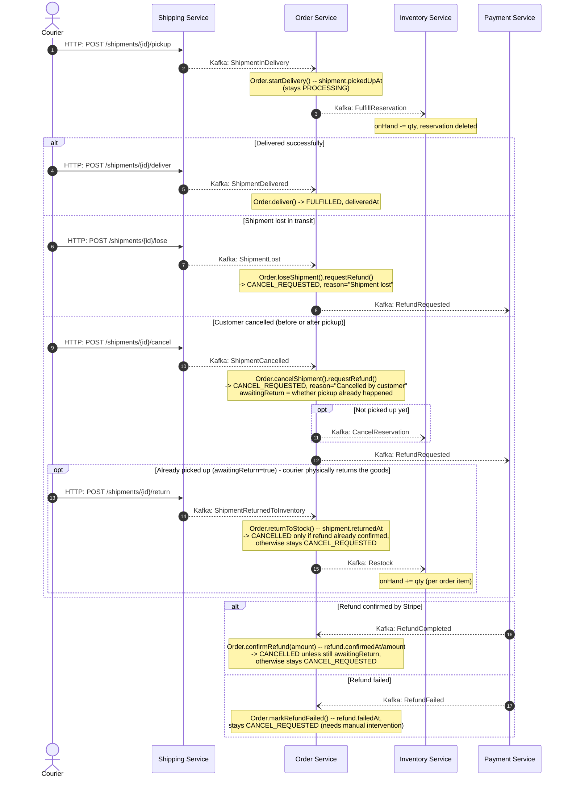

# Order Saga

Order Service is the orchestrator of the order placement saga. This document
describes the full path of an order from checkout to delivery: who talks to
whom and how (HTTP or Kafka), and what happens on failure at each step.

## Legend

An `alt / else` block in a diagram marks a failure branch and its compensation.

## Order states

`OrderStatus` covers five broad values - the detailed saga progress
(payment confirmed, picked up, returned to inventory, etc.) isn't tracked as
separate statuses but as nullable facts on `Order` (`paymentConfirmedAt`,
`shipment.pickedUpAt`, `shipment.deliveredAt`, `refund.confirmedAt`,
`refund.failedAt`, `shipment.returnedAt`) plus an `awaitingReturn` flag.

Labels above are kept short for rendering; exact `cancellationReason` values
for each `-> CANCELLED` / `-> CANCEL_REQUESTED` trigger are listed in
"Compensation steps" below.

`RefundFailed` deliberately doesn't move the status - it's a flag for support
(`refund.failedAt`), not a separate stage: without manual intervention
(re-requesting the refund) the order simply stays in `CANCEL_REQUESTED`. This
is intentional: staying in `CANCEL_REQUESTED` instead of moving to some
dead-end status keeps the order visible in whatever view tracks "still needs
to be resolved" - so an order with a failed refund can't quietly fall through
the cracks and get forgotten.

## Protocol: checkout → payment → shipment creation

## Protocol: delivery → outcome (Delivered / Lost / Cancelled)

Continues from the point where the `Shipment` has already been created
(status `Created`, `Order` in `PROCESSING`). Courier actions
(`pickup`/`deliver`/`lose`/`cancel`/`return`) are HTTP calls made directly to
the Shipping Service, not through Order.

`RefundCompleted`/`RefundFailed` and `ShipmentReturnedToInventory` are two
independent events that can arrive in either order (refund confirmation is
typically much faster than the courier's physical trip back).
`Order.confirmRefund`/`Order.returnToStock` each check whether the OTHER half
has already completed before finalizing to `CANCELLED` - that's exactly what
`awaitingReturn` is for.

## Compensation steps - quick summary

**Out of stock.** The cheapest failure point - before the order is stored, before
the PaymentIntent is created and before any charge. Just return an error to the
frontend: no order exists, so there is nothing to compensate.

**Payment service unavailable or crashed.** The reservation already exists,
the `POST /api/v1/payments` request threw before Stripe ever responded. The
compensation is the same action: `CancelReservation` in Inventory.

**Payment declined (Stripe).** The reservation already exists, no money was
charged. The compensation is one action: `CancelReservation` in Inventory.

**Shipment creation failed.** Money was already charged, the reservation is
still held. The compensation is threefold: cancel the reservation in
Inventory, request a refund from Payment, and wait for its confirmation - all
through Kafka.

**Shipment cancelled BEFORE pickup.** The reservation hasn't been fulfilled
yet - the compensation mirrors the previous case: `CancelReservation` +
`RefundRequested`.

**Shipment cancelled AFTER pickup.** Stock has already been physically
decremented (`FulfillReservation` already ran) - `CancelReservation` makes no
sense here. Instead, the order waits for TWO independent events: refund
confirmation and the courier physically returning the goods (`Restock` in
Inventory). Only once both have happened does the order become `CANCELLED`.

**Shipment lost after pickup.** The goods are never coming back
(`awaitingReturn` is always `false` on this path) - the only compensation is
`RefundRequested` via Kafka to Payment.

**Refund failed at Stripe.** `RefundFailed` only flags `refund.failedAt` -
the order stays in `CANCEL_REQUESTED` with no automatic retry; it needs
manual intervention (support / re-requesting the refund).

## Kafka topics

One topic per producing domain + message kind (command/event). Message ordering for a given aggregate (order /
shipment) is guaranteed by the partitioning key (`orderId`), not
by splitting into topics.

| Topic | Producer | Consumer | Messages |
|---|---|---|---|
| `inventory.commands` | Order | Inventory | `CancelReservation`, `FulfillReservation`, `HoldReservation`, `Restock` |
| `shipping.commands` | Order | Shipping | `CreateShipment` |
| `payment.commands` | Order | Payment | `RefundRequested` |
| `payment.events` | Payment | Order | `PaymentCompleted`, `PaymentFailed`, `RefundCompleted`, `RefundFailed` |
| `shipping.events` | Shipping | Order | `ShipmentCreated`, `ShipmentInDelivery`, `ShipmentDelivered`, `ShipmentCancelled`, `ShipmentLost`, `ShipmentReturnedToInventory` |

Commands (`*.commands`) are an order to a specific service to do one targeted
thing. Events (`*.events`) are a fact that happened. Every message carries
an `eventType`, `correlationId`, `eventId` envelope on top of the JSON
payload, so a consumer on a topic with multiple message types can correctly
recognize what just arrived.
